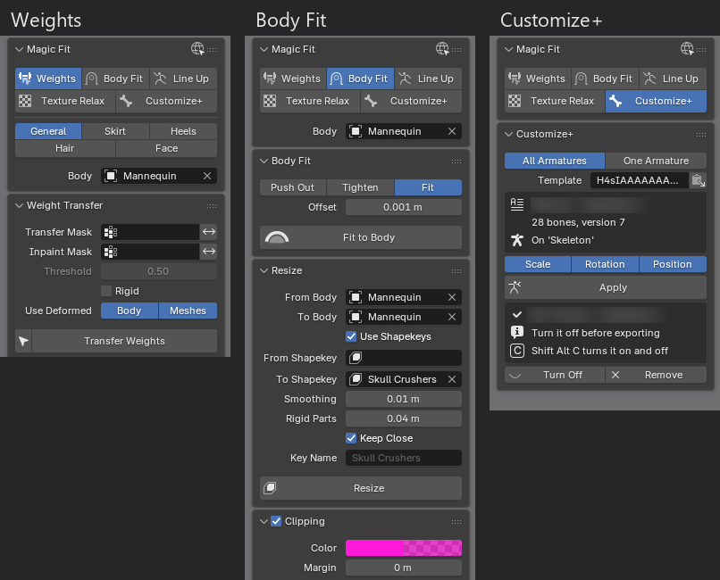

# Magic Fit

Magic Fit is a Blender add-on for Final Fantasy XIV modders. It gets clothing, hair and faces ready for the game: it gives meshes the weights they need to move with a character, fits clothing to a body, resizes outfits between body mods, lines up models from other games and repairs what porting leaves behind.



**New here?** Install it below. The [wiki](https://github.com/link-0402/MagicFit/wiki) explains every tool step by step.

## What do you want to do?

| I want to… | Use | Read |
| --- | --- | --- |
| Make clothing move with a character's body | Weight Transfer, Connect Parts | [Weight Transfer](https://github.com/link-0402/MagicFit/wiki/Weight-Transfer) |
| Fix weights where they look wrong | Weight Brushes | [Weight Brushes](https://github.com/link-0402/MagicFit/wiki/Weight-Brushes) |
| Make skirts swing and heels stay stiff | Skirt and Heel weights | [Skirt and Heel Weights](https://github.com/link-0402/MagicFit/wiki/Skirt-and-Heel-Weights) |
| Weight new hair or a custom face | Hair and Face weights | [Hair Weights](https://github.com/link-0402/MagicFit/wiki/Hair-Weights), [Face Weights](https://github.com/link-0402/MagicFit/wiki/Face-Weights) |
| Push clothing out of the body where it clips | Body Fit, Fit Move | [Body Fit](https://github.com/link-0402/MagicFit/wiki/Body-Fit) |
| Move an outfit to another body mod or size | Auto Resize | [Auto Resize](https://github.com/link-0402/MagicFit/wiki/Auto-Resize) |
| Bring in a model from another game | Line Up | [Line Up](https://github.com/link-0402/MagicFit/wiki/Line-Up) |
| Fix stretched textures, torn seams, messy meshes, bad shading or UVs | Mesh Repair | [Texture Relax and Close Rips](https://github.com/link-0402/MagicFit/wiki/Texture-Relax-and-Close-Rips), [Rebuild Mesh](https://github.com/link-0402/MagicFit/wiki/Rebuild-Mesh) |
| See how a Customize+ template changes an outfit | Customize+ | [Customize+](https://github.com/link-0402/MagicFit/wiki/Customize-Plus) |

## Requirements

- **Blender 5.2 or newer.**
- **64-bit Windows for Weight Transfer.** It needs SciPy, and the copy that comes with the add-on is built for Windows. Everything else works on any system.
- **A full body mesh with an armature** (the skeleton it's attached to) for the tools that work against a body, such as weight transfer, line up and fitting. Lining up hair needs the face model's skin instead.
- **FFXIV installed on the same computer** for Face Weights. It reads the game's faces from your install the first time you use it.

## Installation

Add this repository to Blender once. You then install Magic Fit from Blender and get updates automatically.

1. In Blender, open **Edit → Preferences → Get Extensions**.
2. Click **Repositories**, click **+**, and choose **Add Remote Repository**.
3. Paste this address:

   ```
   https://raw.githubusercontent.com/link-0402/MagicFit/main/blender_repo/index.json
   ```
4. Tick **Check for Updates on Startup**.
5. Find **Magic Fit** in the list and click **Install**. The download is about 32 MB because it includes SciPy, which Blender sets up for you.
6. In the 3D Viewport, press **N** and open the **Magic Fit** tab.

More help is on the wiki's [Installation and Setup](https://github.com/link-0402/MagicFit/wiki/Installation-and-Setup) page.

## Good to know

- **Turn Customize+ off before exporting.** Otherwise the exporter can bake the template into your mesh.
- **Ctrl Z undoes** every button and brush stroke.
- **A dashed brush circle** means the brush can't work yet. The text under it says why, for example that no Body is picked.
- **New hair needs one more step in Penumbra.** Hair Weights tells you which EST entry to set. See [Hair Weights](https://github.com/link-0402/MagicFit/wiki/Hair-Weights).

## Help

Something not working? Try [Troubleshooting and FAQ](https://github.com/link-0402/MagicFit/wiki/Troubleshooting-and-FAQ). If that doesn't help, or a model from another game doesn't line up, please [open an issue](https://github.com/link-0402/MagicFit/issues).

## Credits

- **Weight Transfer** started as [Robust Weight Transfer](https://jinxxy.com/SentFromSpaceVR/robust-weight-transfer) by [sentfromspacevr](https://github.com/sentfromspacevr), which implements [Robust Skin Weights Transfer via Weight Inpainting](https://github.com/rin-23/RobustSkinWeightsTransferCode) by Rinat Abdrashitov et al.
- **Customize+** reproduces the template math of [Customize+](https://github.com/Aether-Tools/CustomizePlus) by Aether-Tools.
- **Bundled libraries:** [SciPy](https://scipy.org), [robust-laplacian](https://github.com/nmwsharp/robust-laplacian-py) and [XIVPy](https://github.com/Arrenval/XIVPy).

Papers, game data and licenses are on the wiki's [Credits](https://github.com/link-0402/MagicFit/wiki/Credits) page.

## License

Magic Fit is licensed under the [GNU General Public License v3.0 or later](magic_fit/LICENSE). To build it from source or run the tests, read the [development notes](docs/development.md).
